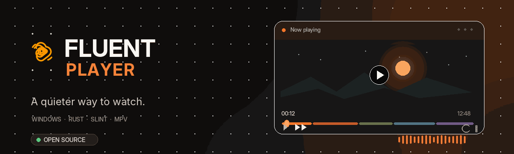

<p align="center">
  
</p>

<p align="center">
  
</p>

<p align="center">
  <a href="https://github.com/masum-9t9/fluent-player/releases/download/v0.0.1/FluentPlayer-v0.0.1.exe"></a>
  <a href="https://github.com/masum-9t9/fluent-player/releases"></a>
  <a href="https://www.rust-lang.org/"></a>
  <a href="https://www.gnu.org/licenses/gpl-3.0.html"></a>
</p>

<p align="center">
  <strong>A quieter way to watch.</strong><br />
  A native Windows video player built with <strong>Rust</strong>, <strong>Slint</strong> and <strong>mpv</strong>.<br />
  Minimal by design. Capable when you need it.
</p>

<p align="center">
  <a href="https://github.com/masum-9t9/fluent-player/releases/download/v0.0.1/FluentPlayer-v0.0.1.exe"><strong>↓ Download v0.0.1</strong></a> ·
  <a href="#screenshots"><strong>See the app</strong></a> ·
  <a href="#features"><strong>Explore features</strong></a> ·
  <a href="#build-from-source"><strong>Build from source</strong></a> ·
  <a href="https://github.com/masum-9t9/fluent-player/issues/new"><strong>Report an issue</strong></a>
</p>

---

## A focused media experience

Fluent Player pairs a dark charcoal interface with a warm orange accent and a compact playback workspace. It is designed to keep the video in focus while making everyday controls easy to reach—without turning the player into a complicated media suite.

## Screenshots

<table>
  <tr>
    <td width="50%" valign="top">
      <p align="center"><strong>Home · Media Hub</strong></p>
      <a href="https://i.postimg.cc/1zp9Gy6B/Screenshot-%284%29.png"></a>
    </td>
    <td width="50%" valign="top">
      <p align="center"><strong>Video playback</strong></p>
      <a href="https://i.postimg.cc/1RWycCgL/Screenshot-%285%29.png"></a>
    </td>
  </tr>
</table>

## Features

<table>
  <tr>
    <td width="50%" valign="top">
      <h3>✦ Minimal interface</h3>
      Native Slint UI, animated controls, reduced-motion option, custom title bar, library navigation and a focused playback layout.
    </td>
    <td width="50%" valign="top">
      <h3>▶ Flexible playback</h3>
      mpv-powered playback with seeking, previous/next, frame stepping, mute, subtitle/audio track cycling, repeat modes and A–B looping.
    </td>
  </tr>
  <tr>
    <td width="50%" valign="top">
      <h3>▤ Your media, organized</h3>
      Open individual files or scan a folder. Browse recent items, playback history, favorites and the current playlist.
    </td>
    <td width="50%" valign="top">
      <h3>⚙ Playback tools</h3>
      Picture-in-picture, screenshots, hardware-decoding toggle, 0.25×–4× speed, volume up to 200%, and brightness, contrast, saturation and gamma adjustments.
    </td>
  </tr>
</table>

Recent items and playback preferences are stored locally in the user's application-data directory.

### Supported media

Video extensions include `MP4`, `MKV`, `WebM`, `MOV`, `AVI`, `WMV`, `M4V`, `MPG/MPEG`, `TS/M2TS`, `3GP`, `OGV`, `FLV` and `VOB`. Folder scanning also recognizes `MP3`, `FLAC` and `WAV` audio files.

> Format and codec support depends on the included mpv runtime and its build configuration.

## Download

<p align="center">
  <a href="https://github.com/masum-9t9/fluent-player/releases/download/v0.0.1/FluentPlayer-v0.0.1.exe"></a>
</p>

- **Direct download:** [FluentPlayer-v0.0.1.exe](https://github.com/masum-9t9/fluent-player/releases/download/v0.0.1/FluentPlayer-v0.0.1.exe)
- **All releases and portable packages:** [GitHub Releases](https://github.com/masum-9t9/fluent-player/releases)

The portable package needs `FluentPlayer.exe` and the matching `libmpv-2.dll` in the same folder. Check the release package and notes for the files included in each download. The local `release/` directory contains build artifacts and is intentionally excluded from Git.

## Requirements

- Windows 10 or Windows 11 (x86-64).
- For playback, the matching release's `libmpv-2.dll` alongside `FluentPlayer.exe`.
- To build: Rust 1.92+, MSVC C++ Build Tools, the Windows SDK (`rc.exe` embeds the app icon), and the x64 `libmpv-2.dll` in `third_party/mpv/`.

The mpv runtime DLL is distributed separately from the source repository because it exceeds GitHub's regular per-file limit.

## Build from source

1. Install the requirements above.
2. Obtain the x64 mpv runtime described in [`third_party/mpv/README.md`](third_party/mpv/README.md) and place `libmpv-2.dll` in `third_party/mpv/`.
3. Build the application:

   ```powershell
   cargo build --release
   ```

   The executable is written to `target/release/fluent_player.exe`.

4. To prepare the versioned application and portable ZIP under `release/`, run:

   ```powershell
   ./scripts/package-release.ps1
   ```

The packaging script copies the runtime and notices into the release packages.

## Technology & third-party components

| Component | Role |
| --- | --- |
| [Rust](https://www.rust-lang.org/) | Application language and toolchain |
| [Slint](https://slint.dev/) | Declarative user interface |
| [mpv](https://github.com/mpv-player/mpv) / `libmpv-2.dll` | Media playback engine, dynamically loaded at runtime |
| [mpv Windows build](https://github.com/shinchiro/mpv-winbuild-cmake/releases/tag/20261019) | Runtime build documented for this project |

Runtime build provenance and checksum are documented in [`third_party/mpv/README.md`](third_party/mpv/README.md).

## Licensing

Fluent Player declares `GPL-3.0-only` in `Cargo.toml`. Read the [GNU GPL v3](https://www.gnu.org/licenses/gpl-3.0.html). mpv and its bundled dependencies have their own license terms; review their notices and source obligations before redistributing binaries. See [`third_party/mpv/README.md`](third_party/mpv/README.md).

## Project links

- **Developer:** Masum 9T9
- **Website:** [fluent-9t9.vercel.app](https://fluent-9t9.vercel.app)
- **Portfolio:** [9t9.pro.bd](https://www.9t9.pro.bd/)
- **GitHub:** [@masum-9t9](https://github.com/masum-9t9/)
- **Facebook:** [Masum 9T9 Official](https://www.facebook.com/masum.9t9.official)
- **Official logo:** [Open image](https://i.postimg.cc/qMdxwL9j/Fluent-Player.jpg)

## Contributing & support

Found a bug or have a feature request? Open a **[GitHub Issue](https://github.com/masum-9t9/fluent-player/issues/new)**. Pull requests are welcome.

When reporting playback problems, include your Windows version, reproduction steps and relevant logs.

---

<p align="center">
  <strong>Fluent Player</strong><br />
  <sub>Play what you want. Find the moment you need. Nothing unnecessary.</sub><br /><br />
  © 2026 <strong>Masum 9T9</strong>
</p>
